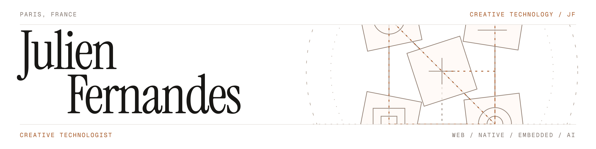

I'm a Creative Technology engineering student at ESILV, building interfaces, software, and embedded systems at the intersection of code, design, and creativity.

From web to hardware, I explore what makes an experience feel clear, tangible, and interactive.

[Portfolio](https://julien-fernandes.vercel.app) · [LinkedIn](https://www.linkedin.com/in/julien-fernandes-61a957370/)
